# Dokumentasi Skema Database (ERD v2) — Gianyar Planner

Dokumen ini mendeskripsikan arsitektur basis data relasional v2 untuk platform **Gianyar Planner**. Skema ini dirancang untuk mengatasi keterbatasan v1 (seperti ketersediaan guide per tanggal, relasi kepemilikan gear mitra, reservasi stok per periode tanggal, pemisahan siklus status pemesanan, dan audit log).

---

## 1. Diagram ERD v2 (Mermaid)

```mermaid
erDiagram
    users ||--o| tour_guides : "has profile"
    users ||--o| mitras : "has profile"
    users ||--o{ itineraries : "creates"
    users ||--o{ pesanans : "orders"
    users ||--o{ notifications : "receives"
    users ||--o{ audit_logs : "acts (actor)"

    tour_guides ||--o{ guide_availabilities : "manages dates"
    tour_guides ||--o{ pesanan_guides : "assigned to"

    mitras ||--o{ travel_gears : "owns"
    mitras ||--o{ pesanan_items : "fulfills"

    gear_categories ||--o{ travel_gears : "categorizes"

    travel_gears ||--o{ gear_reservations : "reserved in"
    travel_gears ||--o{ pesanan_items : "ordered as"

    destinasis ||--o{ itinerary_items : "referenced in"

    itineraries ||--o{ itinerary_items : "composed of"
    itineraries ||--o| pesanans : "booked in"

    pesanans ||--o| pesanan_guides : "includes guide"
    pesanans ||--o{ pesanan_items : "includes gear"

    pesanan_items ||--o| gear_reservations : "holds stock"

    users {
        bigint id PK
        string nama
        string email UK
        string no_hp
        string password
        string role "super_admin | user | tour_guide | mitra"
        string status "pending | active | rejected | suspended"
        timestamp email_verified_at
        timestamps timestamps
    }

    tour_guides {
        bigint id PK
        bigint user_id FK,UK
        text bio
        json bahasa
        json spesialisasi
        string area_layanan
        unsigned_int tarif_per_hari
        unsigned_tinyint max_peserta
        unsigned_tinyint pengalaman_tahun
        string nomor_lisensi
        text foto
        text foto_ktp "private storage"
        text sertifikat_lisensi "private storage"
        decimal rating_avg
        unsigned_int jumlah_ulasan
        unsigned_int jumlah_job_selesai
        decimal acceptance_rate
        string status_verifikasi "pending | approved | rejected | suspended"
        text catatan_verifikasi
        bigint verified_by FK
        timestamp verified_at
        timestamps timestamps
    }

    guide_availabilities {
        bigint id PK
        bigint guide_id FK
        date tanggal
        string status "tersedia | diblokir_guide | ditahan | terpesan"
        string booking_ref
        timestamps timestamps
    }

    mitras {
        bigint id PK
        bigint user_id FK,UK
        string nama_usaha
        text alamat
        string kecamatan
        decimal lat
        decimal lng
        text deskripsi
        string jam_operasional
        string metode_serah "ambil_di_tempat | antar_ke_hotel | keduanya"
        text foto_ktp "private storage"
        text bukti_usaha "private storage"
        string status_verifikasi "pending | approved | rejected | suspended"
        text catatan_verifikasi
        bigint verified_by FK
        timestamp verified_at
        decimal rating_avg
        timestamps timestamps
    }

    gear_categories {
        bigint id PK
        string kode UK
        string nama
        string sifat "per_orang | per_kelompok"
        unsigned_tinyint kelompok_per_unit
        string ikon
        text deskripsi
        timestamps timestamps
    }

    travel_gears {
        bigint id PK
        bigint mitra_id FK
        bigint gear_category_id FK
        string nama_barang
        text deskripsi
        string tipe "sewa | beli"
        unsigned_int harga
        unsigned_int deposit
        unsigned_int stok_total
        json varian
        json tags_aktivitas
        text foto
        boolean is_active
        timestamps timestamps
    }

    gear_reservations {
        bigint id PK
        bigint gear_id FK
        bigint pesanan_item_id FK
        date tanggal_mulai
        date tanggal_selesai
        unsigned_int qty
        string status "ditahan | dikonfirmasi | dibatalkan | selesai"
        timestamps timestamps
    }

    destinasis {
        bigint id PK
        string nama_destinasi
        string nama
        string slug UK
        string kecamatan
        string lokasi
        decimal lat
        decimal lng
        string kategori_utama
        json subkategori
        string kategori
        json tags
        unsigned_int harga_tiket
        unsigned_smallint durasi_kunjungan_menit
        string jam_buka
        string jam_tutup
        json waktu_terbaik
        string tingkat_fisik
        unsigned_tinyint popularitas
        json cocok_untuk
        json rekomendasi_travel_gear
        text tips
        text guide_singkat
        text deskripsi
        text foto
        string zona
        json slot_ideal
        boolean is_active
        timestamps timestamps
    }

    itineraries {
        bigint id PK
        bigint user_id FK
        date tgl_berangkat
        date tgl_pulang
        unsigned_tinyint durasi
        unsigned_tinyint jumlah_orang
        json kategori
        string tipe_traveler
        string tingkat_fisik
        string status "draft | tersimpan | terkunci"
        unsigned_bigint seed
        unsigned_bigint seed_dasar
        unsigned_smallint versi
        unsigned_smallint jumlah_edit
        timestamps timestamps
    }

    itinerary_items {
        bigint id PK
        bigint itinerary_id FK
        bigint destinasi_id FK
        unsigned_tinyint hari_ke
        unsigned_tinyint urutan
        string slot "pagi | siang | sore"
        string slot_label
        string jam_mulai
        string jam_selesai
        unsigned_smallint durasi_menit
        unsigned_smallint durasi_override_menit
        decimal jarak_dari_sebelumnya_km
        unsigned_smallint waktu_tempuh_menit
        text alasan
        boolean is_locked
        string sumber
        text catatan_user
        timestamps timestamps
    }

    pesanans {
        bigint id PK
        bigint user_id FK
        bigint itinerary_id FK
        string kode_tiket UK
        date tgl_pesan
        unsigned_int total_bayar
        string status_pembayaran "belum_bayar | menunggu_verifikasi | lunas | ditolak | refund"
        text bukti_upload
        string status_pesanan "menunggu_konfirmasi | dikonfirmasi | menunggu_pembayaran | terkonfirmasi | berlangsung | selesai | dibatalkan"
        timestamp expires_at
        text catatan_admin
        timestamps timestamps
    }

    pesanan_guides {
        bigint id PK
        bigint pesanan_id FK
        bigint guide_id FK
        date tanggal_mulai
        date tanggal_selesai
        unsigned_int tarif_snapshot
        string status "dipilih | menunggu_konfirmasi_guide | dikonfirmasi_guide | terkonfirmasi | berlangsung | selesai | ditolak | kedaluwarsa | dibatalkan_user | dibatalkan_guide"
        text alasan_penolakan
        timestamp responded_at
        timestamp expires_at
        timestamps timestamps
    }

    pesanan_items {
        bigint id PK
        bigint pesanan_id FK
        bigint gear_id FK
        bigint mitra_id FK
        unsigned_int qty
        unsigned_int harga_snapshot
        unsigned_tinyint jumlah_hari
        string status "menunggu_konfirmasi_mitra | dikonfirmasi_mitra | siap_diambil | dipakai | dikembalikan | selesai | ditolak | kedaluwarsa | dibatalkan"
        string metode_serah "ambil_di_tempat | antar_ke_hotel"
        text alamat_antar
        text alasan_penolakan
        timestamp expires_at
        timestamps timestamps
    }

    notifications {
        bigint id PK
        bigint user_id FK
        string tipe
        string judul
        text isi
        json data
        timestamp read_at
        timestamps timestamps
    }

    audit_logs {
        bigint id PK
        bigint actor_id FK
        string aksi
        string target_type
        unsigned_bigint target_id
        json meta
        timestamp created_at
    }
```

---

## 2. Rincian Domain & Tabel

### A. Domain Pengguna & Autentikasi (Users)
- **`users`**: Sumber otentikasi tunggal. Mendukung 4 peran (`super_admin`, `user`, `tour_guide`, `mitra`) dengan 4 siklus status akun (`pending`, `active`, `rejected`, `suspended`).

### B. Domain Destinasi & Itinerary
- **`destinasis`**: Master 42 destinasi Kabupaten Gianyar dengan atribut spasial lengkap (koordinat, zona, waktu terbaik, tingkat fisik, popularitas, dan rekomendasi gear).
- **`itineraries`**: Header jadwal perjalanan otomatis. Status dapat berupa `draft`, `tersimpan`, dan `terkunci` (terkunci otomatis saat ada pesanan terkonfirmasi/lunas). Memiliki kolom `versi`, `seed_dasar`, dan `jumlah_edit`.
- **`itinerary_items`**: Rincian kunjungan destinasi per slot waktu (pagi, siang, sore), jarak dari destinasi sebelumnya (Haversine), waktu tempuh, dan alasan rekomendasi. Mendukung `is_locked`, `durasi_override_menit`, dan `catatan_user`.

### C. Domain Tour Guide & Anti Double-Booking
- **`tour_guides`**: Profil pemandu lokal terverifikasi, tarif harian, bahasa, area layanan, dan spesialisasi yang sinkron dengan subkategori destinasi. Dokumen KTP dan lisensi disimpan di storage privat.
- **`guide_availabilities`**: Tabel sumber kebenaran ketersediaan guide per tanggal. Memiliki unique constraint `(guide_id, tanggal)` untuk menjamin tidak ada tanggal ganda per pemandu di level database.

### D. Domain Mitra & Inventaris Travel Gear
- **`mitras`**: Profil pemilik usaha penyewaan gear. Dokumen KTP dan bukti usaha disimpan di storage privat.
- **`gear_categories`**: Master kategori gear dengan spesifikasi perhitungan unit (`per_orang` vs `per_kelompok`).
- **`travel_gears`**: Katalog perlengkapan milik mitra. Menyimpan tipe (`sewa` atau `beli`), harga harian, deposit, stok total, dan tag aktivitas.
- **`gear_reservations`**: Reservasi stok terikat rentang tanggal sewa untuk menghitung sisa stok dinamis.

### E. Domain Pemesanan Multi-Siklus (Pesanan)
- **`pesanans`**: Header pemesanan transaksi wisatawan dengan status pembayaran dan kode tiket unik.
- **`pesanan_guides`**: Siklus konfirmasi pemandu mandiri (`menunggu_konfirmasi_guide` $\rightarrow$ `dikonfirmasi_guide` $\rightarrow$ `terkonfirmasi`).
- **`pesanan_items`**: Siklus konfirmasi per barang milik mitra (`menunggu_konfirmasi_mitra` $\rightarrow$ `dikonfirmasi_mitra` $\rightarrow$ `siap_diambil` $\rightarrow$ `dikembalikan`).

### F. Domain Notifikasi & Jejak Audit
- **`notifications`**: Notifikasi in-app untuk semua peran pengguna (pemesanan masuk, verifikasi disetujui/ditolak, jatuh tempo pembayaran).
- **`audit_logs`**: Catatan jejak keputusan super admin dan transisi status kritis.
